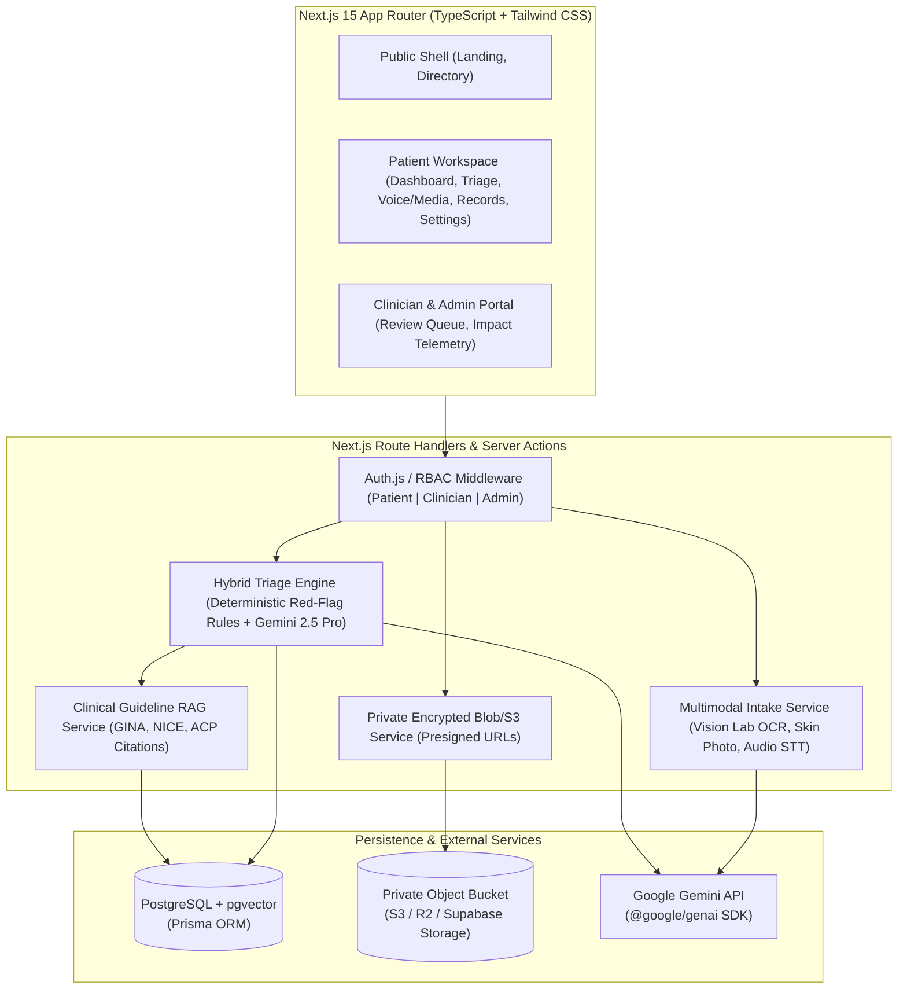

# CareNavigator — Full-Stack Architecture, Design-System Audit & Implementation Plan

## 1. Repository & Design Archive Inspection

### 1.1 Current Repository State
An inspection of the workspace (`/Users/sanjidabdullah/Documents/AI_builders_project`) confirms that **no application codebase exists yet** (no `package.json`, source directory, database schema, or backend services). The repository currently contains only:
1. `stitch_remix_of_healthcare_saas_design_system.zip` (5,264,259 bytes) — The original design archive.
2. `design-reference:` — An extracted directory (note the literal trailing colon `:` in the directory name on disk) containing the exact contents of `stitch_remix_of_healthcare_saas_design_system/` inside the zip archive.

### 1.2 Archive Verification
The archive `stitch_remix_of_healthcare_saas_design_system.zip` was extracted to an isolated scratch location and compared against `design-reference:` via `diff -rq`. Both directories are byte-for-byte identical and contain **11 screen directories** (`code.html` + `screen.png` each) and **4 design-system specification directories** (`DESIGN.md` each):

- **Design Systems (4 variants)**:
  1. `clinical_calm_minimal/DESIGN.md`
  2. `clinical_clarity_1/DESIGN.md`
  3. `clinical_clarity_2/DESIGN.md`
  4. `clinical_clarity_3/DESIGN.md`
- **Screens (11 directories)**:
  1. `carenavigator_ai_assisted_triage_care_navigation`
  2. `carenavigator_patient_dashboard`
  3. `ai_health_assessment_triage_workspace`
  4. `media_voice_assessment`
  5. `patient_health_profile_documents`
  6. `clinical_assessment_results`
  7. `assessment_history_clinician_review_tracker`
  8. `doctor_directory`
  9. `carenavigator_privacy_communication_settings`
  10. `carenavigator_notification_center`
  11. `admin_impact_dashboard`

---

## 2. Screen Inventory & Interaction Audit

Every `code.html` and `screen.png` file was inspected. Below is the complete inventory of all 11 screens, including their layout shell, assigned design-system variant, header persona, UI sections, **actual working client-side JavaScript**, and **non-functional/placeholder controls**.

### 2.1 Summary Matrix of Screens

| # | Screen Directory | Proposed Route | Shell Type | Design Variant | Persona Displayed in Header | Working JS Interactions in HTML |
| :--- | :--- | :--- | :--- | :--- | :--- | :--- |
| 1 | `carenavigator_ai_assisted_triage_care_navigation` | `/` | `web_standard` (Top Nav + Footer) | `clinical_calm_minimal` | Public / Unauthenticated | **None** (100% static HTML/CSS) |
| 2 | `carenavigator_patient_dashboard` | `/dashboard` | `web_dashboard` (Sidebar `w-64` + Top Bar) | `clinical_clarity_1` | `Elena Rostova` (`#44092-B`, Patient) | **None** (100% static HTML/CSS) |
| 3 | `ai_health_assessment_triage_workspace` | `/assessments/new` | `web_dashboard` (Sidebar `w-64` + Top Bar) | `clinical_clarity_2` | `Eleanor Vance` (`#CN-8841`, Patient) | Consent switch dims synced data panel; quick-symptom pills toggle active state; voice button simulates 3.2s recording and appends hardcoded text |
| 4 | `media_voice_assessment` | `/assessments/media-voice` | `web_dashboard` (Sidebar `w-64` + Top Bar) | `clinical_clarity_3` | `Dr. Sarah Lin` (Attending Clinician)* | **None** (CSS hover only; upload, camera, audio player, and tabs are static) |
| 5 | `patient_health_profile_documents` | `/records` | `web_dashboard` (Sidebar `w-64` + Submenu) | `clinical_calm_minimal` | `Sarah Jenkins` (`#CN-84920`, Patient) | **None** (Table filters, search, PDF viewer, and tabs are static) |
| 6 | `clinical_assessment_results` | `/assessments/[id]/results` | `web_dashboard` (Sidebar `w-64` + Top Bar) | `clinical_clarity_3` | `Dr. A. Vance` (Internal Medicine)* | Native HTML `
` accordions for 3 citations; `window.print()` on Export PDF & Save Summary buttons |
| 7 | `assessment_history_clinician_review_tracker` | `/assessments/history` | `web_dashboard` (Sidebar `w-64` + Top Bar) | `clinical_clarity_2` | `Dr. Evelyn Vance` (Attending Physician)* | **None** (Search, status tabs, and timeline actions are static) |
| 8 | `doctor_directory` | `/care-directory` | `web_standard` (Top Nav + Footer) | `clinical_calm_minimal` | Public / Patient | Form `event.preventDefault()`; visual-only toggle between "List View" and "Split Map" buttons |
| 9 | `carenavigator_privacy_communication_settings` | `/settings/privacy` | `web_dashboard` (Sidebar `w-72` + Top Bar) | `clinical_clarity_2` | `Sarah Jenkins` (Patient) | CSS `peer` toggles; Account Deletion modal opens, validates typing `'DELETE'`, and triggers a 4s toast; Save Preferences button triggers a 4s toast |
| 10 | `carenavigator_notification_center` | `/notifications` | `web_dashboard` (Sidebar `w-72` + Top Bar) | `clinical_clarity_2` | `Sarah Jenkins` (Patient) | Category filter chips (`all`, `clinical`, `appointment`, `reminder`, `record`); "Unread only" toggle; mark single/all read; dismiss card with fade-out animation & counter update |
| 11 | `admin_impact_dashboard` | `/admin/impact` | `web_dashboard` (Sidebar `w-64` + Top Bar) | `clinical_calm_minimal` | `Dr. Clara Vance` (Chief Medical Officer) | **None** (CSS `group-hover` dropdown on Export Report and metric tooltips only) |

*\*Note on Persona Mismatches in Reference Designs: Screens 4, 6, and 7 display a clinician name/title in the top-right profile header (`Dr. Sarah Lin`, `Dr. A. Vance`, `Dr. Evelyn Vance`), even though their main content and sidebar navigation are explicitly written from the **patient's perspective** (e.g., "Upload a Clear Photo", "Action Required from You: Upload Supplemental ECG", "My Health Profile"). Section 4.4 details how we will normalize role-based headers.*

---

### 2.2 Detailed Screen-by-Screen Breakdown

#### 1. Landing Page (`carenavigator_ai_assisted_triage_care_navigation`)
- **Files**: `code.html` (413 lines), `screen.png`
- **Sections**:
  - Sticky top navigation (`data-purpose="global-header"`): Brand logo, links (`How It Works`, `Services`, `Doctors`, `Partner Hospitals`, `About Us`), `Sign In`, and `Start Assessment` CTA.
  - Hero section: Trust badge ("HIPAA Compliant & Clinician-Verified"), headline ("Clarity and Clinical Precision When You Need Care Most"), dual CTAs (`Start Free Assessment`, `Explore Care Options`), trust indicators (`24/7 Clinical Triage`, `Board-Certified Review`, `Encrypted Health Records`), and a visual preview card showing a live triage session (`Urgent Care Recommended within 24hrs`, `94% Clinical Match`, `Dr. Sarah Jenkins, MD`).
  - 4-Step Workflow ("How CareNavigator Works"): `01 Symptom & Voice Intake`, `02 Clinical AI Analysis`, `03 Clinician Verification`, `04 Guided Care Routing`.
  - Core Capabilities Bento Grid: Multimodal AI Intake (Voice, Lab PDFs, Photo), Longitudinal Health Vault, Smart Specialist Matching, Transparent Clinical Evidence.
  - Safety & Governance Dark Banner (`bg-inverse-surface`): Highlights deterministic red-flag escalation, zero-retention LLM agreements, and board-certified oversight.
  - 4-column Footer (`Platform`, `Clinical Governance`, `Company & Support`, legal links) + persistent bottom medical emergency disclaimer banner (`Call 911 immediately...`).
- **Working vs. Non-Functional**: Zero JavaScript. All 21 links point to `href="#"`.

#### 2. Patient Dashboard (`carenavigator_patient_dashboard`)
- **Files**: `code.html` (427 lines), `screen.png`
- **Sections**:
  - Left sidebar (`w-64`) + fixed top header with search input (`Search records, doctors, symptoms...`), emergency alert pill (`Emergency: Call 911`), notification bell, and patient profile (`Elena Rostova`, `MRN: #44092-B`).
  - Welcome header with `Review Recent Lab` and `+ New Assessment` CTAs.
  - **Active Triage Status Banner**: Highlights `Routine Clinician Follow-Up Recommended` (`Assessment #TR-8839`, submitted Oct 24, 10:15 AM) with a 4-step horizontal progress stepper (`Intake Complete` → `AI Analysis` → `Clinician Review [In Progress]` → `Care Plan Ready`) and `View Full Triage Report` CTA.
  - **Quick Action Cards (4-grid)**: `Start Symptom Triage`, `Voice & Photo Intake`, `Upload Lab Results`, `Book Specialist`.
  - **Recent Clinical Assessments Table**: Shows 3 rows (`Persistent Migraine & Visual Aura` [Urgent Care], `Seasonal Allergic Rhinitis` [Self-Care], `Routine Blood Panel Follow-up` [Routine Consultation]) with status badges and `Report` links.
  - **Health Profile Snapshot**: Vitals grid (`Blood Pressure 118/76`, `Heart Rate 68 bpm`, `SpO2 99%`, `Weight 142 lbs`), Active Conditions (`Mild Asthma`, `Seasonal Allergies`), Active Medications (`Albuterol HFA 90mcg`, `Loratadine 10mg`), and Allergies (`Penicillin — Severe`).
  - **Upcoming Care Card**: Telehealth video visit with `Dr. Marcus Vance, MD` (Neurology) + `Pre-Visit Checklist` and `Join Waiting Room` CTA.
- **Working vs. Non-Functional**: Zero JavaScript. Search bar, notification bell, table actions, and CTAs are static HTML.

#### 3. AI Health Assessment & Triage Workspace (`ai_health_assessment_triage_workspace`)
- **Files**: `code.html` (494 lines), `screen.png`
- **Sections**:
  - Top bar with session badge (`Session #TR-9042 • Encrypted`), `Save Draft` button, and `Emergency: 911` button.
  - **3-Step Progress Bar**: `Step 1: Symptom & Context Intake (Active)` → `Step 2: Clinical Follow-up Q&A` → `Step 3: Triage & Care Routing`.
  - **Left Column (7 cols — Intake Controls)**:
    - **Health Profile Sync Card**: Toggle switch (`#consent-toggle`) to include/exclude longitudinal EHR context (`#synced-data-panel`: Age `34 yrs`, Sex `Female`, Conditions `Asthma (Mild), Migraine`, Medications `Albuterol PRN, Sumatriptan`, Allergies `Penicillin (Hives)`).
    - **Conversational AI Intake Chat**: Multi-turn message feed with AI clinical assistant prompts, structured symptom clarification cards (e.g., pain location, radiation, shortness of breath), quick-select symptom pills (`.quick-pill`: `Chest Tightness`, `Shortness of Breath`, `Dizziness`, `Nausea`, `Fatigue`, `Radiating Pain`), free-text clinical notes textarea (`#clinical-notes-input`), and voice dictation trigger (`#voice-intake-btn`) with animated listening bar (`#voice-indicator`).
  - **Right Column (5 cols — Live Clinical Context)**:
    - **Extracted Clinical Entities Card**: Live tags for Primary Symptoms (`Substernal Chest Pressure [Onset: 2h ago]`, `Exertional Dyspnea [Moderate]`), Pertinent Negatives (`No Diaphoresis`, `No Left Arm Radiation`), and Risk Modifiers (`History of Bronchospasm`).
    - **Preliminary Acuity Signal**: `Urgent Clinical Evaluation` (Amber warning level) with explanation and `Proceed to Clinical Q&A` CTA.
    - **Red-Flag Safety Check**: Checklist showing screened critical conditions (`Acute Coronary Syndrome`, `Pulmonary Embolism`, `Status Asthmaticus`).
- **Working vs. Non-Functional**:
  - *Working*: `#consent-toggle` toggles `aria-checked` and sets `#synced-data-panel` opacity to `0.35`; `.quick-pill` buttons toggle single-selection active styles; `#voice-intake-btn` reveals `#voice-indicator` and after `3200ms` appends `" Also experiencing mild lightheadedness when standing up quickly."` to `#clinical-notes-input`.
  - *Non-Functional*: Submitting the chat message, `Save Draft`, `Attach Media/Labs`, and `Proceed to Clinical Q&A` do not persist or navigate.

#### 4. Media & Voice Assessment (`media_voice_assessment`)
- **Files**: `code.html` (405 lines), `screen.png`
- **Sections**:
  - Mode Switcher Tabs: `Media Upload (Photos & Documents)` [Active], `Voice Conversation`, `Text Assessment`.
  - **Left Column (7 cols — Upload & Audio Controls)**:
    - Drag-and-drop upload zone (`JPG, PNG, HEIC, or PDF up to 25MB`) with `Browse Files` and `Capture with Camera` buttons + clinical photography tips (`Good Lighting`, `Clear Focus`, `Include Scale/Context`).
    - Uploaded Media Queue: Shows `forearm_rash_day3.jpg` (Analyzed, 2.4 MB, tagged `Dermatology / Skin Lesion`) and `urgent_care_discharge_summary.pdf` (OCR Complete, 1.1 MB).
    - **Voice Symptom Recording Panel**: Interactive-looking audio waveform (`00:42 / 01:15`), record/pause/re-record controls, and AI-transcribed symptom narrative with highlighted clinical terms (`erythematous maculopapular rash`, `pruritus`, `no systemic fever`).
  - **Right Column (5 cols — AI Multimodal Preliminary Insights)**:
    - **Non-Diagnostic Disclaimer Banner**: Explicit notice that visual AI observations require clinician confirmation.
    - **Visual & Audio Observation Summary**: Morphological features (`Well-demarcated erythematous patch, ~4cm diameter`), Preliminary Differential Context (`Contact Dermatitis`, `Tinea Corporis`, `Nummular Eczema`), and Recommended Next Step (`Routine Dermatology or Primary Care Consult within 3–5 days`).
    - Bottom action bar: `Back to Intake` and `Include in Triage Assessment`.
- **Working vs. Non-Functional**: Zero JavaScript. File dropzone, camera trigger, delete buttons, audio waveform playback, and tab switcher are completely static.

#### 5. Patient Health Profile & Documents (`patient_health_profile_documents`)
- **Files**: `code.html` (626 lines), `screen.png`
- **Sections**:
  - Sidebar with expanded `Medical Records` sub-navigation (`Health Profile`, `Diagnostic Labs`).
  - Patient Demographic Summary Header (`Sarah Jenkins`, `DOB: 04/12/1986 (38 yrs)`, `Blood Type: O+`, `Primary Care: Dr. Aris Thorne, MD`, `Last Synced: Today, 09:41 AM`) + `Share Records` and `+ Upload Document` CTAs.
  - **5 Horizontal Sub-Tabs**: `Overview`, `Medical History`, `Prescriptions`, `Test Reports (Active, 14)`, `Diagnoses`.
  - **Left Column (4 cols — Structured Clinical Summary)**:
    - Chronic Conditions (`Type 2 Diabetes Mellitus — Controlled`, `Essential Hypertension`), Active Allergies (`Penicillin [Anaphylaxis]`, `Sulfonamides [Rash]`), Active Medications (`Metformin 500mg BID`, `Lisinopril 10mg QD`), Immunization & Surgical History.
  - **Right Column (8 cols — Document Repository & Inline AI Document Inspector)**:
    - Filter bar: Search input, Category select (`All Categories`, `Lab Results`, `Imaging`, `Discharge Summaries`), Date filter, and 5-row documents table (`Comprehensive Metabolic Panel & HbA1c`, `Chest Radiograph (PA & Lateral)`, `Cardiology Consult Note`, `Lipid Panel & TSH`, `Annual Physical Summary`).
    - **Document Detail / AI Extraction Drawer (Bottom Panel)**: Inspects `Comprehensive_Metabolic_Panel_Oct2023.pdf`, showing structured biomarker extraction (`HbA1c: 6.4% [Pre-Diabetic/Controlled]`, `Fasting Glucose: 108 mg/dL [Slightly Elevated]`, `eGFR: >90 mL/min [Normal]`) alongside an AI Plain-Language Patient Summary and `Download Original PDF` button.
- **Working vs. Non-Functional**: Zero JavaScript. Sub-tabs, search, dropdowns, table row selection, pagination, and upload buttons are static.

#### 6. Clinical Assessment Results (`clinical_assessment_results`)
- **Files**: `code.html` (356 lines), `screen.png`
- **Sections**:
  - Top Action Bar: Assessment metadata (`Assessment ID: #CN-2026-8841`, `Completed: Oct 24, 2026 • 14:32 EST`), `Save Summary` button, and `Export PDF` button.
  - **Hero Triage Recommendation Banner**: High-visibility Amber Urgency Card (`Urgent Evaluation Recommended — Seek Care Within 24 Hours`), Confidence Score (`92% High Clinical Confidence`), Care Setting (`In-Person Urgent Care or Same-Day Primary Care`), and Primary CTAs (`Find Urgent Care Near Me`, `Book Telehealth Consult`).
  - **Left Column (7 cols — Clinical Reasoning & Differential)**:
    - **Plain-Language Summary ("Why We Recommend This")**: Explains the synthesis of acute pleuritic chest discomfort, mild dyspnea, and history of asthma.
    - **Potential Considerations (Non-Diagnostic Differential)**: Progress-bar probability cards for `Acute Bronchospasm / Asthma Exacerbation (High Match)`, `Costochondritis / Musculoskeletal Strain (Moderate Match)`, and `Atypical Respiratory Tract Infection (Lower Match)`.
    - **Evidence-Based Clinical Guidelines (3 `
` Accordions)**: Cites `GINA 2025 Asthma Management Guidelines`, `ACP Clinical Guidelines: Acute Chest Pain Evaluation in Outpatient Settings`, and `NICE Guideline NG191: Respiratory Tract Assessment`.
  - **Right Column (5 cols — Red Flags & Preparation)**:
    - **Red-Flag Warning Box ("When to Go to the ER Immediately")**: High-contrast alert listing emergency escalation triggers (crushing chest pain, cyanosis, inability to speak full sentences).
    - **Doctor Visit Preparation Checklist**: Questions to ask the clinician and items to bring (inhaler log, pulse oximeter readings).
- **Working vs. Non-Functional**:
  - *Working*: `
` accordions expand/collapse natively; `Export PDF` and `Save Summary` invoke `window.print()`.
  - *Non-Functional*: `Find Urgent Care Near Me` and `Book Telehealth Consult` links do not navigate.

#### 7. Assessment History & Clinician Review Tracker (`assessment_history_clinician_review_tracker`)
- **Files**: `code.html` (413 lines), `screen.png`
- **Sections**:
  - Header with search input (`Search by symptom, ID, or clinician...`), status filter tabs (`All (5)`, `Pending Review (2)`, `Completed (2)`, `Draft (1)`, `Failed`, `Cancelled`), and `+ New Assessment` button.
  - **Split Master-Detail Workspace**:
    - **Left Column (5 cols — Longitudinal Assessment Feed)**: 5 timeline cards showing various states:
      1. `#CN-9042` (`Exertional Chest Tightness & Wheezing` — **Under Clinician Review**, Urgent, Assigned to `Dr. Aris Thorne, MD`).
      2. `#CN-8910` (`Persistent Right Knee Swelling` — **Action Required: Info Requested**, Routine).
      3. `#CN-8754` (`Migraine with Visual Aura` — **Draft Saved**, 65% complete).
      4. `#CN-8402` (`Annual Lab Panel Interpretation` — **Clinician Verified**, Self-Care / Routine).
      5. `#CN-8119` (`Voice Intake Upload` — **Processing Failed**, Audio corrupted, with `Retry` CTA).
    - **Right Column (7 cols — Live Clinician Review Detail Panel for `#CN-9042`)**:
      - **4-Stage Verification Tracker**: `1. AI Triage Generated (10:12 AM)` → `2. Queued for Specialty Review (10:13 AM)` → `3. Clinician Reviewing [Active — Dr. Aris Thorne, MD]` → `4. Final Care Plan Signed`.
      - **Patient Action Required Alert Banner**: Requests upload of recent home peak-flow meter log or Apple Watch ECG strip (`Upload Requested File` CTA).
      - **Clinician Preliminary Note**: Signed note from Dr. Thorne confirming agreement with Urgent Care within 24h and advising 2 puffs of Albuterol PRN.
      - **Comparison Card**: Shows `AI Initial Triage (Urgent Care <24h)` alongside `Clinician Verified Status (Pending Final Sign-Off)`.
- **Working vs. Non-Functional**: Zero JavaScript. Filter tabs, search bar, card selection, and `Upload Requested File` are static.

#### 8. Doctor & Facility Directory (`doctor_directory`)
- **Files**: `code.html` (356 lines), `screen.png`
- **Sections**:
  - Top `web_standard` navigation bar + contextual Triage Match Banner (`Filtered by Triage #CN-2026-8841: Pulmonology & Urgent Primary Care within 10 miles`).
  - **Search & Filter Controls**: Keyword input (`Specialty, condition, doctor, or hospital name...`), Location input (`San Francisco, CA 94103`), Insurance selector (`BlueCross BlueShield PPO`), quick filter pills (`Available Today`, `Accepts My Insurance`, `Telehealth Available`, `Top Rated (4.8+)`, `In-Network Hospital`), Sort dropdown, and `List View` / `Split Map` toggle buttons (`#viewToggleGroup`).
  - **Left Column (7 cols — Provider Cards)**:
    - 4 detailed clinician cards (`Dr. Elena Rostova, MD` — Pulmonology; `Dr. Marcus Vance, MD` — Internal Medicine; `Dr. Priya Patel, MD` — Urgent Care; `Dr. Julian Sterling, DO` — Family Medicine) with `98% Triage Match` badges, NPI verification, hospital affiliation, next available time slots (`Today, 2:30 PM`, `Today, 4:15 PM`, `Tomorrow, 9:00 AM`), and `Book Consultation` / `View Profile` buttons.
    - Pagination bar (`Showing 1–4 of 28 matching specialists`).
  - **Right Column (5 cols — Sticky Interactive Map Mockup)**:
    - Map container (`data-location="San Francisco, CA"`) with custom price/availability pins, selected doctor callout card, and `Search This Area` button.
- **Working vs. Non-Functional**:
  - *Working*: `<form onsubmit="event.preventDefault();">` and visual-only active class switching on `#viewToggleGroup` (`List View` vs `Split Map`).
  - *Non-Functional*: Map is a static background image with positioned HTML pins; slot buttons, booking buttons, filter pills, and pagination do not function.

#### 9. Privacy, Consent & Communication Settings (`carenavigator_privacy_communication_settings`)
- **Files**: `code.html` (413 lines), `screen.png`
- **Sections**:
  - Left sidebar (`w-72`) with grouped navigation (`Clinical Workspace` & `Account & System`).
  - **Data Governance & AI Consent Section**:
    - Granular toggle cards using CSS `peer` checkboxes:
      1. `Longitudinal EHR & Lab Context in AI Triage` (Checked)
      2. `Multimodal Voice & Audio Transcription Storage` (Checked)
      3. `De-Identified Clinical Model Improvement` (Unchecked by default)
      4. `Automated Health Information Exchange (HIE) Sync` (Checked)
  - **Communication & Alert Preferences**:
    - Matrix of Email / SMS / Push toggles for `Critical Clinical Escalations (Mandatory — Locked On)`, `Clinician Review Updates`, `Appointment Reminders`, and `Preventive Care Nudges`.
  - **Data Portability & Right to Erasure (GDPR / HIPAA)**:
    - `Export Complete Health Archive (FHIR JSON & PDF)` button.
    - **Danger Zone**: `Request Account Deletion & Purge Data` button opening `#deletion-modal`.
  - **Confirmation Modal (`#deletion-modal`) & Toast (`#toast-notification`)**: Requires typing `'DELETE'` into `#delete-confirm-input` to enable `#delete-confirm-btn`.
- **Working vs. Non-Functional**:
  - *Working*: Modal open/close (`openModal()`, `closeModal()`), typing `'DELETE'` validation (`checkDeleteMatch()`), `executePurge()` and `saveSettingsNotification()` displaying `#toast-notification`.
  - *Non-Functional*: Settings state is not saved to any backend or `localStorage`; `Export Complete Health Archive` button has no handler.

#### 10. Notification Center (`carenavigator_notification_center`)
- **Files**: `code.html` (415 lines), `screen.png`
- **Sections**:
  - Header with unread badge (`#unread-counter`: `3 Unread`), `Unread only` switch (`#unread-toggle`), and `Mark all as read` button (`#mark-all-read-btn`).
  - **Category Filter Bar**: `.filter-chip` buttons (`All Alerts`, `Clinical & Triage`, `Appointments`, `Medications & Reminders`, `Medical Records`).
  - **Notification Feed (`#notification-list`)**: 5 structured cards with `data-category` and `data-read` attributes:
    1. `clinical` (unread): **Urgent Triage Review Completed** (`Dr. Aris Thorne, MD` signed off on `#CN-9042` — CTA: `View Verified Care Plan`).
    2. `record` (unread): **New Lab Results Available & Analyzed** (`Comprehensive Metabolic Panel` flagged elevated fasting glucose — CTA: `Inspect Biomarkers`).
    3. `appointment` (unread): **Upcoming Telehealth Consult in 2 Hours** (`Dr. Marcus Vance, MD` — CTA: `Complete Pre-Check`).
    4. `reminder` (read): **Action Requested: Peak Flow Log** (Supplemental upload reminder).
    5. `clinical` (read): **Prescription Refill Authorized** (`Albuterol HFA 90mcg` sent to Walgreens).
- **Working vs. Non-Functional**:
  - *Working*: Complete client-side DOM filtering by category and unread state, mark single/all as read, card dismissal with opacity/translate transition, and empty-state display (`#empty-state`) when all matching notifications are cleared.
  - *Non-Functional*: State resets on page refresh; action CTAs inside cards link to `href="#"`.

#### 11. Admin & Clinical Operations Impact Dashboard (`admin_impact_dashboard`)
- **Files**: `code.html` (427 lines), `screen.png`
- **Sections**:
  - Admin Sidebar (`Clinical Operations`: `Overview`, `Impact & Metrics`, `Triage Governance`, `Clinician Roster`; `Compliance & Security`: `Audit Logs`, `Security & Access`).
  - Top bar with Date Range Selector (`Last 30 Days: Oct 1 – Oct 30, 2026`), Cohort filter (`All Patient Cohorts`), and `Export Report` hover dropdown (`Executive PDF Summary`, `Raw CSV Telemetry`, `FHIR Audit Bundle`).
  - **KPI Summary Row (4 Cards with Hover Tooltips)**:
    1. `Total AI Triage Sessions`: `14,892` (`+18.4% vs prior 30d`).
    2. `Clinician Concordance Rate`: `96.4%` (`+1.2%` — agreement between AI acuity and board-certified reviewer).
    3. `Avoided Unnecessary ER Visits`: `2,140` (`Est. $3.42M Plan Savings`).
    4. `Median Time to Care Routing`: `4m 12s` (`-42s improvement`).
  - **Charts & Analytics Grid**:
    - **Acuity Distribution & Safe Redirection Chart**: Stacked horizontal bars comparing Self-Care (`34%`), Routine Primary Care (`41%`), Urgent Care `<24h` (`19%`), and Emergency ER (`6%`).
    - **AI-to-Clinician Escalation Funnel**: Shows `100% Intake Started` → `91.2% Completed Triage` → `25.0% Flagged for Human Review` → `99.8% SLA Met (<15 min)`.
  - **Recent High-Risk Escalation Audit Log Table**: Lists anonymized patient sessions (`PT-9921-A`, `PT-8840-C`, `PT-7712-B`, `PT-6509-F`), AI Acuity vs. Clinician Override status, review latency (`3m 14s`), and `Inspect Audit Trail` links.
- **Working vs. Non-Functional**: Zero JavaScript (uses CSS `group-hover` for export menu and metric info tooltips). Date range picker, cohort selector, and audit log links are static.

---

## 3. Design-System Audit & Normalization Specification

A thorough audit of all 4 `DESIGN.md` files and the 11 HTML `<script id="tailwind-config">` blocks revealed **three major categories of conflict** that must be normalized into a single canonical design system before building components.

### 3.1 Conflict 1: Prose vs. YAML/Tailwind Token Discrepancy (Across All 4 `DESIGN.md` Files)
Every `DESIGN.md` file contains two contradictory specifications:
1. **The Markdown Prose Sections** describe a classic flat SaaS palette:
   - Canvas background `#F7FAFC`, Pure white cards `#FFFFFF` with `1px solid #E2E8F0` borders, Primary Teal `#087F8C`, Secondary Cyan `#36BFCB`, Medical Blue `#2563A6`, Primary Text `#243746`, Secondary Text `#64748B`, Success `#21865B`, Warning `#B7791F`, Emergency `#C62828`, and `rounded-lg: 1rem (16px)`.
2. **The YAML Frontmatter & Actual HTML `<script id="tailwind-config">` Blocks** implement a **Material Design 3 (M3) Tonal Surface System** ("The Sanctuary of Clinical Clarity"):
   - Uses tonal layering (`surface: #f8f9ff` / `#f6f9ff`, `surface-container-lowest: #ffffff`, `surface-container-low: #eff4ff` / `#ecf5ff`, `surface-container: #e6effc`, `primary: #00646f`, `primary-container: #087f8c`, `outline-variant: #bec8ca` at `15%–20%` opacity).
   - **Critical Border-Radius Override Bug in HTML**: All 11 HTML files override Tailwind's `borderRadius` config to `{ DEFAULT: "0.25rem", lg: "0.5rem", xl: "0.75rem", full: "9999px" }`. Because Tailwind's standard `rounded-lg` is `0.5rem (8px)` and `rounded-xl` is `0.75rem (12px)`, this custom config matches standard Tailwind for `lg`/`xl` while omitting `2xl` (`1rem`), even though the HTML markup extensively uses `rounded-xl` and `rounded-2xl`!

### 3.2 Conflict 2: Divergent Color & Typography Tokens Across the 4 Variants

| Token / Property | Variant A (`clinical_calm_minimal`) | Variant B (`clinical_clarity_1`) | Variant C (`clinical_clarity_2`) | Variant D (`clinical_clarity_3`) |
| :--- | :--- | :--- | :--- | :--- |
| **Screens Using Variant** | Landing, Health Profile, Doctor Directory, Admin Impact (4) | Patient Dashboard (1) | Triage Workspace, History Tracker, Privacy Settings, Notifications (4) | Media/Voice Intake, Assessment Results (2) |
| `primary` / `primary-container` | `#00646f` / `#087f8c` | `#00646f` / `#087f8c` | `#00646f` / `#087f8c` | `#00646f` / `#087f8c` |
| **`secondary`** | `#006970` (Teal) | `#006970` (Teal) | **`#2060a3` (Medical Blue)** | **`#2060a3` (Medical Blue)** |
| **`tertiary`** | **`#1a5c9e` (Medical Blue)** | **`#1a5c9e` (Medical Blue)** | `#00656c` (Teal) | `#00656c` (Teal) |
| `surface` | `#f8f9ff` | `#f6f9ff` | `#f6f9ff` | `#f6f9ff` |
| `on-surface` | `#001d37` | `#091d2b` | `#091d2b` | `#091d2b` |
| `inverse-surface` | `#16324f` | `#1f3241` | `#1f3241` | `#1f3241` |
| `headline-xl` | `2.25rem` (36px) / `700` | `36px` / `600` | `32px` / `600` | `display: 36px / 700` |
| `headline-lg` | `1.75rem` (28px) / `600` | `28px` / `600` | `24px` / `600` | `30px` / `600` |
| `headline-md` | `1.375rem` (22px) / `600` | `20px` / `600` | `20px` / `600` | `22px` / `600` |
| `body-md` | `1rem` (16px) / `400` | `14px` / `400` | `14px` / `400` | `14px` / `400` |
| `body-sm` | `0.875rem` (14px) / `400` | `13px` / `400` | `12px` / `400` | `13px` / `400` |
| **Chip Border Radius** | `rounded-full` (`9999px`) | `rounded-full` (`9999px`) | Prose says `4px/6px` (No `9999px`), HTML uses `rounded-full` | `rounded-full` (`9999px`) |

> [!WARNING]
> **Critical Token Swap (`secondary` vs. `tertiary`)**: Variants A and B assign `secondary` to Teal (`#006970`) and `tertiary` to Medical Blue (`#1a5c9e`), whereas Variants C and D swap them (`secondary: #2060a3` Medical Blue, `tertiary: #00656c` Teal). If left un-normalized, buttons and badges using `bg-secondary-container` or `text-tertiary` will flip between teal and blue depending on which page the user views.

### 3.3 Canonical Unified Design System Specification
To preserve the exact visual appearance of all 11 screens while eliminating token collisions, we will define a single **Canonical CareNavigator Theme** in `tailwind.config.ts` and `app/globals.css`:

1. **Color Palette (Unified M3 + Semantic Clinical Tokens)**:
   - **Primary (Deep Clinical Teal)**: `primary: #00646f`, `primary-container: #087f8c`, `on-primary: #ffffff`, `primary-fixed: #9df0fb`, `on-primary-fixed: #001f24`.
   - **Secondary (Medical Trust Blue — standardized from Variants C/D where `secondary` is actually used for informational/clinical badges)**: `secondary: #2060a3`, `secondary-container: #d4e3ff`, `on-secondary-container: #001c3a`.
   - **Tertiary (Calm Cyan/Teal Accent)**: `tertiary: #006970`, `tertiary-container: #74f5ff`, `on-tertiary-container: #002022`.
   - **Tonal Surfaces**: `surface: #f6f9ff`, `surface-bright: #f8f9ff`, `surface-container-lowest: #ffffff`, `surface-container-low: #ecf5ff`, `surface-container: #e5eeff`, `surface-container-high: #dde9ff`, `surface-container-highest: #d6e3ff`, `inverse-surface: #16324f`.
   - **Typography & Borders**: `on-surface: #091d2b`, `on-surface-variant: #3f484a`, `outline: #6f797b`, `outline-variant: #bec8ca`.
   - **Semantic Clinical Acuity Tokens** (explicitly named so acuity never depends on `secondary`/`tertiary`):
     - `acuity-selfcare` (Green): Text `#14532d`, Bg `#dcfce7`, Border `#86efac`, Accent `#21865b`
     - `acuity-routine` (Medical Blue): Text `#1e3a8a`, Bg `#dbeafe`, Border `#93c5fd`, Accent `#2060a3`
     - `acuity-urgent` (Amber Warning): Text `#78350f`, Bg `#fef3c7`, Border `#fcd34d`, Accent `#b7791f`
     - `acuity-emergency` (Crimson Error): Text `#7f1d1d`, Bg `#fee2e2`, Border `#fca5a5`, Accent `#ba1a1a`
2. **Typography & Iconography**:
   - **Primary & Headline Font**: `'Plus Jakarta Sans'`, weights `400, 500, 600, 700, 800`.
   - **Monospace Font (IDs, MRNs, Timestamps, Lab Values)**: `'JetBrains Mono'` (used in `admin_impact_dashboard` and `assessment_history_clinician_review_tracker`).
   - **Icons**: `@material-symbols/font-400` (`Material Symbols Outlined`, variable axes `FILL 0..1, wght 400, GRAD 0, opsz 24`).
3. **Border Radius & Elevation**:
   - Keep standard Tailwind radii (`rounded-sm: 4px`, `rounded: 6px`, `rounded-md: 8px`, `rounded-lg: 12px`, `rounded-xl: 16px`, `rounded-2xl: 20px`, `rounded-full: 9999px`) so all card classes render with the soft clinical aesthetic shown in the PNG screenshots.
   - Ambient clinical shadow: `0 10px 30px -5px rgba(9, 29, 43, 0.04), 0 4px 12px -2px rgba(0, 100, 111, 0.03)`.

---

## 4. Navigation, Component Inventory & Gap Analysis

### 4.1 Sidebar & Shell Fragmentation Across the 11 Screens
Across the 9 `web_dashboard` screens, the left sidebar changes width (`w-64` vs. `w-72`), changes item names, and mixes 3 different user roles:
- **Patient Sidebar Variant 1** (Dashboard, Triage Workspace, Media/Voice, Results): 8–9 flat items (`Overview`, `AI Health Assessment`, `Media & Voice`, `Find a Doctor`, `Medical Records`, `Assessment History`, `Appointments`, `Settings`, `Support`).
- **Patient Sidebar Variant 2** (Health Profile & Documents): Adds an expandable submenu under `Medical Records` (`Health Profile`, `Diagnostic Labs`).
- **Patient Sidebar Variant 3** (Assessment History): Collapses to 5 items (`Overview`, `Assessments & Triage`, `History & Reviews`, `Health Profile`, `Find Care`).
- **Patient Sidebar Variant 4** (Privacy Settings & Notification Center): Uses `w-72` with 2 section headers: **Clinical Workspace** (`Overview`, `AI Triage Assessment`, `Assessment History`, `Care Team`, `My Health Profile`) and **Account & System** (`Notifications [3]`, `Settings`).
- **Admin Sidebar Variant** (Admin Impact Dashboard): Uses 2 section headers: **Clinical Operations** (`Overview`, `Impact & Metrics`, `Triage Governance`, `Clinician Roster`) and **Compliance & Security** (`Audit Logs`, `Security & Access`).

#### Solution: Unified Role-Aware Application Shell
We will implement **three clean, consistent layouts** driven by user session state:
1. **Public Marketing Shell (`(public)/layout.tsx`)**: Sticky top navbar + footer + persistent 911 medical disclaimer banner (used for `/`, `/care-directory` when unauthenticated, and informational pages).
2. **Patient Workspace Shell (`(patient)/layout.tsx`)**: Standardized `w-64` sidebar combining the best of Variant 1 & Variant 4:
   - **Clinical Workspace**:
     - `Overview` (`/dashboard`)
     - `AI Health Assessment` (`/assessments/new`)
     - `Media & Voice Intake` (`/assessments/media-voice`)
     - `Assessment History` (`/assessments/history`)
     - `Medical Records & Labs` (`/records`)
     - `Find Care & Doctors` (`/care-directory`)
     - `Appointments` (`/appointments`)
   - **Account & System**:
     - `Notifications` (`/notifications` — with live unread badge)
     - `Privacy & Settings` (`/settings/privacy`)
   - **Footer CTA**: `+ New Assessment` primary gradient button + `Emergency: 911` modal trigger.
3. **Clinician & Admin Portal Shell (`(clinical)/layout.tsx`)**:
   - **Clinical Operations**: `Review Queue` (`/clinician/queue`), `Impact & Metrics` (`/admin/impact`), `Triage Governance` (`/admin/governance`), `Clinician Roster` (`/admin/roster`).
   - **Compliance & Security**: `Audit Logs` (`/admin/audit-logs`), `Security & Access` (`/admin/security`).

### 4.2 Reusable Component Inventory
To avoid duplicating markup across 11+ pages, the UI will be decomposed into the following shared component library (`src/components/`):
1. **Layout & Navigation**: `AppSidebar`, `TopHeaderBar`, `PublicNavbar`, `PublicFooter`, `Emergency911Modal`, `RoleSwitcherBadge` (for demo/testing transition between Patient, Clinician Reviewer, and CMO Admin).
2. **Triage & AI Intake**: `AssessmentProgressStepper` (3-step & 4-step variants), `EhrConsentSyncCard`, `TriageChatFeed`, `QuickSymptomPills`, `VoiceRecorderWidget` (real Web Audio API waveform + live transcription), `MediaDropzoneUploader`, `ExtractedClinicalEntitiesPanel`, `AcuitySignalCard`, `RedFlagChecklistCard`.
3. **Clinical Results & Evidence**: `AcuityHeroBanner` (Self-Care, Routine, Urgent, Emergency states), `DifferentialConsiderationBar`, `EvidenceCitationAccordion`, `VisitPrepChecklist`, `PrintableClinicalSummary`.
4. **Longitudinal Records & History**: `PatientVitalsGrid`, `MedicalSummaryList` (Conditions, Meds, Allergies), `DocumentsTable`, `AiBiomarkerInspectorDrawer`, `AssessmentTimelineCard`, `ClinicianVerificationTracker`.
5. **Care Routing & Directory**: `ProviderSearchFilterBar`, `DoctorMatchCard`, `InteractiveCareMap` (Leaflet/Mapbox or Google Maps with custom clinical pins), `AppointmentSlotPickerModal`.
6. **Governance, Notifications & Admin**: `NotificationItemCard`, `ConsentToggleCard`, `CommunicationMatrixTable`, `DangerZoneDeleteModal`, `KpiMetricCardWithTooltip`, `AcuityDistributionChart`, `EscalationAuditTable`.

### 4.3 Missing Screens & Flows Required for a Complete Application
The HTML archive references several routes and workflows that have no corresponding screen in the zip archive. We will build lightweight, design-consistent views or modals for the essential functional flows:
1. **Authentication & Onboarding (`/login`, `/register`)**: Needed for `data-path="sign-in"`, role selection (Patient vs. Clinician vs. Admin), and initial health profile setup.
2. **Clinician Review Action View (`/clinician/review/[id]`)**: While `assessment_history_clinician_review_tracker` shows the *patient's* view of a pending review, a clinician needs a way to actually approve/override an AI triage session, write the `Clinician Preliminary Note`, or request a supplemental file (like the ECG/Peak Flow log).
3. **Appointment Booking Confirmation Modal & `/appointments` View**: Referenced in the sidebar and on `doctor_directory` (`Book Consultation` / time-slot pills).
4. **Voice Conversation Active Tab & Profile Sub-Tabs**: Switching between `Media Upload`, `Voice Conversation`, and `Text Assessment` in `media_voice_assessment`, and switching tabs (`Overview`, `Medical History`, `Prescriptions`, `Test Reports`, `Diagnoses`) in `patient_health_profile_documents`.

### 4.4 Persona & Header Normalization
In the design reference, the patient name changes across screens (`Elena Rostova` on Dashboard, `Eleanor Vance` on Triage Workspace, `Sarah Jenkins` on Profile/Settings/Notifications, and `Dr. Sarah Lin` / `Dr. A. Vance` / `Dr. Evelyn Vance` erroneously placed in the header of patient screens).
- **Resolution**: In the real application, the top-right header will dynamically bind to the authenticated user's session (e.g., default seeded demo patient `Sarah Jenkins, MRN #CN-84920`, demo clinician `Dr. Aris Thorne, MD`, and demo CMO `Dr. Clara Vance, MD`), with a quick **Demo Persona Switcher** in the header so evaluators can test all three roles seamlessly.

---

## 5. Recommended Full-Stack Architecture

Because no codebase exists yet, we recommend a modern, type-safe, monolithic full-stack architecture optimized for rapid execution, multimodal AI streaming, and healthcare data governance:

### 5.1 Core Technology Stack
- **Framework**: **Next.js 15 (App Router) with TypeScript** — Provides unified server/client rendering, streaming Server-Sent Events (SSE) for conversational triage, API route handlers, and strict type safety.
- **Styling**: **Tailwind CSS v3.4+** configured with the unified CareNavigator M3 color tokens, `Plus Jakarta Sans` + `JetBrains Mono` via `next/font/google`, and `@material-symbols/font-400`.
- **Database & ORM**: **PostgreSQL** with **Prisma ORM** and the **`pgvector`** extension.
  - Stores users, longitudinal health profiles (vitals, conditions, medications, allergies, immunizations), multimodal documents, extracted biomarkers, triage sessions, chat turns, deterministic red-flag audit logs, clinician reviews, notifications, and privacy consent toggles.
  - `pgvector` stores embeddings of curated clinical guidelines (GINA, NICE, ACP, AHA/ACC) so every triage assessment retrieves real, grounded clinical citations.
- **Authentication & Authorization**: **Auth.js (NextAuth v5)** with Credentials + OAuth support and strict Role-Based Access Control (`PATIENT`, `CLINICIAN`, `ADMIN`). Includes a one-click **Demo Role Switcher** for local evaluation.
- **AI, Vision & Speech Processing**: **Google Gemini API (`@google/genai` SDK)** using `gemini-2.5-flash` and `gemini-2.5-pro`:
  - **Conversational Triage & Entity Extraction**: Structured JSON outputs (`responseSchema`) extracting symptoms, onset, pertinent negatives, differential considerations, and acuity level.
  - **Deterministic Safety Guardrail Layer**: A hard-coded clinical rule engine runs *before and alongside* the LLM. If high-risk red flags (e.g., crushing substernal chest pain + dyspnea, stroke FAST signs, suicidal ideation, anaphylaxis) are detected, the system deterministically forces `EMERGENCY` acuity and surfaces the 911 escalation banner regardless of LLM output.
  - **Multimodal Lab OCR & Clinical Image Analysis**: Gemini Vision parses uploaded PDFs/images of lab panels into structured biomarker tables (`HbA1c`, `Fasting Glucose`, `eGFR`, reference ranges, status flags) and provides non-diagnostic morphological observations on skin/wound photos.
  - **Voice Symptom Intake**: Browser `MediaRecorder` + Web Audio API captures audio and renders a real-time waveform; audio is sent to Gemini multimodal audio transcription (or Web Speech API fallback) to generate the highlighted clinical transcript and extracted entities.

---

## 6. External Services & Required Credentials

To run the complete production-grade stack, the following external services and environment variables are used. **To ensure the project runs out-of-the-box in local development even before cloud buckets are provisioned**, we will include automatic local fallbacks for storage and SQLite/local Postgres where appropriate.

| Capability | Recommended Service | Environment Variables Required | Local / Dev Fallback Strategy |
| :--- | :--- | :--- | :--- |
| **1. AI, Multimodal Vision & Audio STT** | **Google Gemini API** (`@google/genai`) | `GEMINI_API_KEY` | Required for live AI triage, lab OCR, photo analysis, and voice transcription. |
| **2. Relational Database & Vector Search** | **PostgreSQL + `pgvector`** (Neon, Supabase, or local Postgres) | `DATABASE_URL` `DIRECT_URL` | Local PostgreSQL instance (or Prisma local dev database seeded with rich clinical guidelines & demo patient records). |
| **3. Authentication & Session Security** | **Auth.js (NextAuth v5)** | `AUTH_SECRET` `NEXTAUTH_URL` | Auto-generated secret in `.env.local` + pre-seeded `Patient`, `Clinician`, and `Admin` accounts. |
| **4. Private Medical File Storage** | **S3-Compatible Private Object Storage** (AWS S3, Cloudflare R2, or Supabase Storage) | `STORAGE_ENDPOINT` `STORAGE_REGION` `STORAGE_ACCESS_KEY_ID` `STORAGE_SECRET_ACCESS_KEY` `STORAGE_BUCKET_NAME` | Encrypted local disk vault (`.local-vault/` outside `public/`) served exclusively through authenticated, short-lived signed API routes (`/api/files/[id]`). |
| **5. Clinical Guideline Retrieval (RAG)** | **PostgreSQL `pgvector` + Gemini Embeddings** (`text-embedding-004`) + optional NCBI E-utilities / EuropePMC API | `GEMINI_API_KEY` *(Optional)* `NCBI_API_KEY` | Pre-seeded local clinical guideline corpus (GINA Asthma, ACP Chest Pain, NICE Respiratory, ADA Diabetes, AAD Dermatology) indexed in the database. |
| **6. Interactive Care Directory Map** | **Leaflet + OpenStreetMap / CartoDB Positron** (or Google Maps JS API) | *(Optional)* `NEXT_PUBLIC_GOOGLE_MAPS_API_KEY` | Works zero-config with Leaflet + high-resolution Carto Positron clinical map tiles and interactive custom SVG pins. |

---

## 7. Phased Implementation Plan

### Milestone 1: Foundation, Canonical Design System & Database Schema
- **Scope**:
  - Initialize Next.js 15 (App Router, TypeScript) project in `/Users/sanjidabdullah/Documents/AI_builders_project`.
  - Configure Tailwind CSS with the **Canonical Unified Design System** (Section 3.3), typography (`Plus Jakarta Sans`, `JetBrains Mono`), and Material Symbols Outlined icons.
  - Define the complete Prisma schema (`User`, `PatientProfile`, `VitalSign`, `MedicalCondition`, `Medication`, `Allergy`, `MedicalDocument`, `ExtractedBiomarker`, `TriageSession`, `TriageMessage`, `ClinicalCitation`, `ClinicianReview`, `DoctorProfile`, `Appointment`, `Notification`, `ConsentPreference`, `AuditLog`).
  - Seed the database with realistic longitudinal data matching the design screens (`Sarah Jenkins`, `Elena Rostova`, `Dr. Aris Thorne`, `Dr. Marcus Vance`, `Dr. Clara Vance`, clinical guidelines, notifications, and audit logs).
  - Build the Public Shell, Patient Workspace Shell, Clinician/Admin Shell, and the header **Demo Persona Switcher**.
- **Dependencies**: None.
- **Testing Criteria**:
  - `npm run build` and `npx tsc --noEmit` succeed with zero errors.
  - Database migrations and seed scripts populate all entities cleanly.
  - All navigation routes render with consistent typography, tonal surfaces, and zero broken `href="#"` links.

### Milestone 2: Core Patient Experience — Landing Page, Dashboard, Health Profile & Document Vault
- **Scope**:
  - Implement Screen 1: **Landing Page (`/`)** with interactive links routing directly into the live assessment workspace and doctor directory.
  - Implement Screen 2: **Patient Dashboard (`/dashboard`)** driven by live database queries (active triage status banner, recent assessments table, vitals/conditions/meds snapshot, and upcoming appointment card).
  - Implement Screen 5: **Patient Health Profile & Documents (`/records`)** with working sub-tabs (`Overview`, `Medical History`, `Prescriptions`, `Test Reports`, `Diagnoses`), working search/category/date filters, private file upload, and live Gemini Vision OCR extraction into the **AI Document & Biomarker Inspector Drawer**.
- **Dependencies**: Milestone 1 + `GEMINI_API_KEY` for live document OCR.
- **Testing Criteria**:
  - Uploading a lab PDF or image stores the file privately, extracts structured biomarkers via Gemini, persists them to the database, and renders the plain-language explanation and biomarker flags in the inspector drawer.

### Milestone 3: Multimodal AI Triage Engine — Chat, Voice, Photo Intake & Clinical Results
- **Scope**:
  - Implement Screen 3: **AI Health Assessment & Triage Workspace (`/assessments/new`)**:
    - Working EHR Profile Sync consent toggle (dynamically includes/excludes patient conditions, medications, and allergies in the AI system context).
    - Multi-turn conversational AI intake with quick-symptom pills, free-text notes, and real-time extraction of Clinical Entities (`Primary Symptoms`, `Pertinent Negatives`, `Risk Modifiers`), Preliminary Acuity Signal, and Deterministic Red-Flag Safety Checks.
  - Implement Screen 4: **Media & Voice Assessment (`/assessments/media-voice`)**:
    - Working drag-and-drop image/PDF uploader and camera capture with Gemini Vision dermatological/clinical observation extraction.
    - Working Web Audio API microphone recorder with live waveform visualization, playback (`play/pause/seek`), and Gemini audio transcription with highlighted clinical terms.
  - Implement Screen 6: **Clinical Assessment Results (`/assessments/[id]/results`)**:
    - Dynamic acuity banner (`Self-Care`, `Routine`, `Urgent`, `Emergency`), confidence score, plain-language reasoning, differential probability bars, RAG-grounded clinical guideline citations (GINA/ACP/NICE accordions), red-flag ER warning box, visit prep checklist, and clean print/PDF export stylesheet.
- **Dependencies**: Milestone 1 & 2, `GEMINI_API_KEY`.
- **Testing Criteria**:
  - Completing an assessment generates a persisted `TriageSession` with grounded clinical guideline citations and navigates to `/assessments/[id]/results`.
  - Entering emergency red-flag symptoms (e.g., severe crushing chest pain radiating to the left arm with shortness of breath) deterministically triggers the `EMERGENCY` acuity state and 911 escalation alert.
  - Toggling EHR consent off demonstrably excludes prior medical history from the triage prompt and logs the consent state on the session.

### Milestone 4: Longitudinal History, Clinician Review Loop & Care Directory
- **Scope**:
  - Implement Screen 7: **Assessment History & Clinician Review Tracker (`/assessments/history`)**:
    - Working search bar and status filter tabs (`All`, `Pending Review`, `Completed`, `Draft`, `Failed`, `Cancelled`).
    - Interactive master-detail selection updating the right-hand 4-stage Clinician Verification Tracker.
    - Working **"Upload Requested File"** flow when a clinician requests supplemental data (e.g., ECG strip or peak-flow log).
    - **Clinician Review Action Panel** (accessible when switched to the `Clinician` persona) allowing Dr. Aris Thorne to verify/override AI acuity, write a signed clinical note, or request patient files—immediately updating the patient's tracker and triggering a notification.
  - Implement Screen 8: **Doctor & Facility Directory (`/care-directory`)**:
    - Contextual filtering from a Triage Result (`?assessmentId=...` automatically filters by recommended specialty and urgency).
    - Working keyword, location, insurance dropdown, quick-filter pills (`Available Today`, `Telehealth`, `Top Rated`), sort selector, and pagination.
    - Working **Interactive Split Map** (Leaflet with custom price/availability pins) + **Book Consultation Modal** that creates a real `Appointment` record visible on the Patient Dashboard.
- **Dependencies**: Milestone 3.
- **Testing Criteria**:
  - Filtering by specialty, insurance, and availability dynamically updates both the provider list and map pins.
  - Booking a time slot creates an appointment and triggers an appointment notification.
  - Signing off on a review as a Clinician updates the assessment status from `PENDING_REVIEW` to `VERIFIED` and sends a notification to the patient.

### Milestone 5: Governance, Privacy Settings, Notifications & Admin Impact Telemetry
- **Scope**:
  - Implement Screen 9: **Privacy, Consent & Communication Settings (`/settings/privacy`)**:
    - Database-persisted AI & Data Governance toggles (directly controlling default EHR sync and voice retention behavior).
    - Persisted Email/SMS/Push communication matrix (with `Critical Clinical Escalations` locked on).
    - Working **Export Complete Health Archive** (downloads a real FHIR-structured JSON/summary bundle of the patient's records).
    - Working **Account Deletion & Data Purge** modal (`DELETE` confirmation) that purges/anonymizes patient records and logs an immutable audit event.
  - Implement Screen 10: **Notification Center (`/notifications`)**:
    - Database-backed notification feed with category filtering, unread toggle, mark single/all as read, dismiss, and live header unread badge sync.
  - Implement Screen 11: **Admin & Clinical Operations Impact Dashboard (`/admin/impact`)**:
    - Live aggregation of platform telemetry (total triage sessions, clinician concordance rate, avoided ER visits, median routing time, acuity distribution bars, escalation funnel) + working date-range/cohort filters, CSV/JSON telemetry export, and High-Risk Escalation Audit Log inspection modal.
- **Dependencies**: Milestone 4.
- **Testing Criteria**:
  - Changing privacy consent toggles persists across page reloads and alters default intake behavior.
  - Exporting telemetry or patient FHIR archives downloads valid, structured files.

### Milestone 6: End-to-End Verification, Accessibility & Security Hardening
- **Scope**:
  - End-to-end verification across all 11 screens and all 3 user personas (`Patient`, `Clinician`, `Admin`).
  - WCAG AA contrast check, keyboard navigation, ARIA live regions for triage chat and notifications, and print stylesheet verification.

---

## 8. Security, Privacy & Clinical Safety Considerations

1. **Deterministic Clinical Red-Flag Override**: LLMs must never be the sole arbiter of life-threatening emergencies. A deterministic symptom & keyword rule engine runs alongside Gemini to guarantee immediate emergency escalation (`Call 911`) for chest pain/ACS, stroke, severe dyspnea, anaphylaxis, or self-harm indicators.
2. **Explicit Non-Diagnostic Framing**: All AI outputs, visual observations, and differential considerations carry clear non-diagnostic framing and require human clinician verification for high-risk pathways.
3. **Private Medical File Storage**: Uploaded lab PDFs, skin photos, and voice recordings are never placed in a public static folder. They are stored in a private vault and accessed only via authenticated, role-verified endpoints.
4. **Granular Consent Enforcement**: The `Longitudinal EHR Sync` toggle on `/settings/privacy` and `/assessments/new` is enforced server-side in the API route before constructing the LLM context window.
5. **Immutable Audit Logging**: Every triage generation, red-flag trigger, clinician acuity override, record export, and data purge request writes an entry to `AuditLog`, surfacing directly in the Admin Impact Dashboard (`admin_impact_dashboard`).

---

## 9. Key Architectural Decisions & Open Questions

### Sensible Defaults Chosen (No Action Needed Unless You Prefer Otherwise)
1. **Stack**: Next.js 15 (App Router, TypeScript, Tailwind CSS) + Prisma + PostgreSQL (with local zero-config development database & private file vault fallback so the app runs immediately).
2. **Design Token Normalization**: Standardized on the Material 3 tonal surface tokens (`#f6f9ff` canvas, `#ffffff` lowest container, `#00646f` primary teal, `#2060a3` secondary medical blue, `#006970` tertiary cyan/teal) + explicit semantic acuity tokens (`selfcare`, `routine`, `urgent`, `emergency`) to resolve the Variant A/B vs. C/D color swap.
3. **Role Normalization**: Unified the header persona so patient screens always show the active Patient profile, while adding a convenient **Demo Role Switcher** (`Patient` / `Clinician` / `CMO Admin`) in the top bar for testing all workflows.

### Optional Confirmation Before Milestone 1
- **AI Provider Credentials**: Do you already have a `GEMINI_API_KEY` (or preferred LLM/database credentials) you would like wired into `.env.local` for Milestone 1–3, or should we configure `.env.example` and include an automatic high-fidelity clinical fallback when no API key is present?
